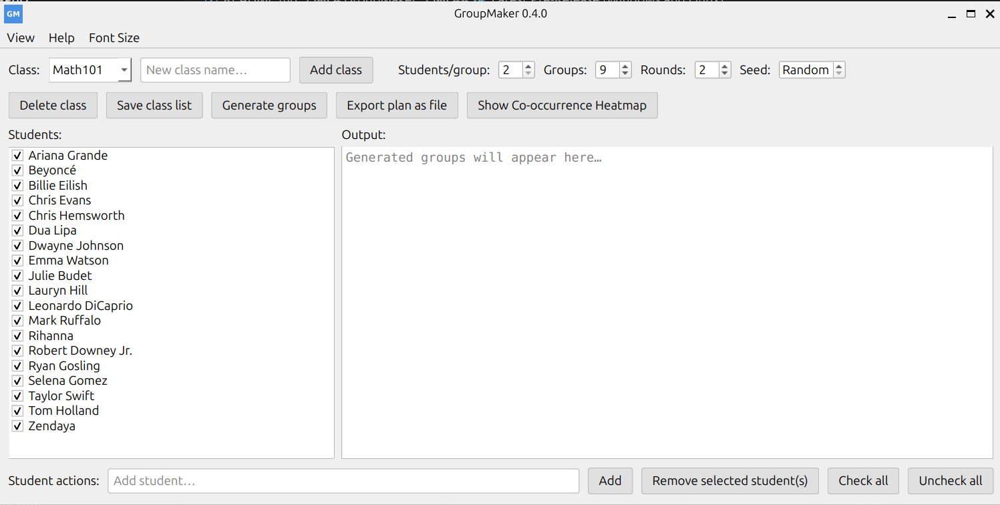
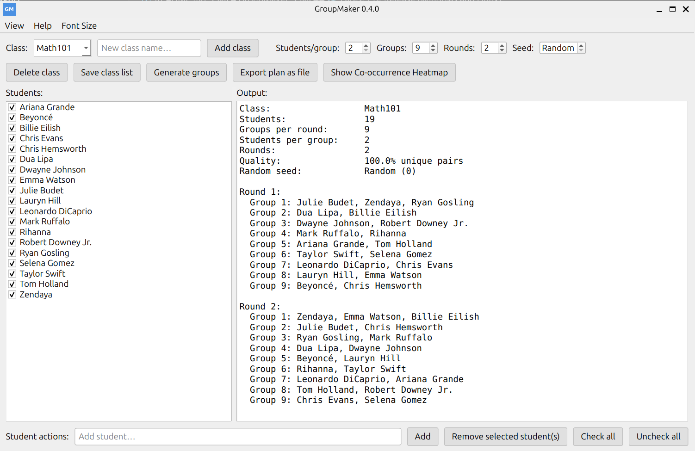
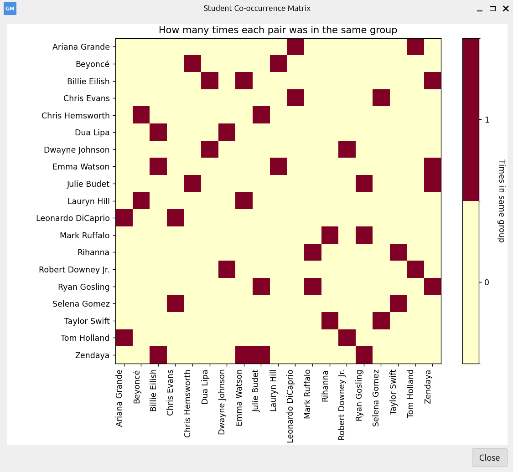

# GroupMaker

Create random student groups with minimal pair repetition, plan classroom seating, keep track of red crosses and time breaks. Built with Python + PySide6.

## Screenshot





## Download
- Latest releases (Windows + Linux):
	- https://github.com/magnussimonsen/StudentGroupMaker/releases/latest

## Features
- Manage multiple classes and student rosters; mark attendance and keep student identities stable when names change
- Add or replace a student photo in Edit classes and optionally show photos under names in Class Seating
- Math101 includes bundled example photos for Taylor Swift and Billie Eilish
- Export selected classes to one JSON file and import them later, including all saved seating charts and, if you choose, their red crosses
- Switch between the Edit classes, Student Groups, Class Seating, Red Crosses and Break Timer tabs
- Create, rename, copy, and delete multiple saved seating charts for each class
- Arrange and move students between seats and the unseated list using drag and drop
- Adjust classroom rows and columns, view spreadsheet-style seat labels, flip the classroom orientation, and export a seating chart as PNG
- Generate configurable student groups and rounds, with a seed value (0 = random)
- Review schedule quality and student co-occurrence with the heatmap
- Export generated group plans to a text file
- Give red crosses in the Red Crosses tab or by clicking the crosses on a student's desk in Class Seating
  - Archive a student's new crosses, or all new crosses in the class at once, so earlier crosses are kept safe from everyday changes
  - Remove or reset new and archived crosses separately; removing archived crosses always asks first
  - Red crosses are hidden until you confirm, in case the screen is shown on a projector
- Count down a break with a large timer that keeps counting after the break is over
- Choose a light or dark theme and adjust the application font size

## Where your data is stored
Classes, seating charts and red crosses are saved automatically as JSON files in `~/.GroupMaker`
(on Windows: `C:\Users\<you>\.GroupMaker`). Student photos are stored separately in its
`student_photos` folder, with their filenames saved in each student's class record. Class exports
include the photos so they are preserved when imported on another computer. Files are written
safely, so a crash never leaves a half-saved file.
If a file is ever damaged, it is kept as `<name>.damaged-<date>.json` next to the original instead of being overwritten.

## Run from source
```bash
python3 -m venv .venv
source .venv/bin/activate
pip install -r requirements.txt
python3 group-maker.py
```

## Linux AppImage
```bash
wget https://github.com/magnussimonsen/StudentGroupMaker/releases/latest/download/GroupMaker-x86_64.AppImage
chmod +x GroupMaker-x86_64.AppImage
./GroupMaker-x86_64.AppImage
# If you hit FUSE issues:
./GroupMaker-x86_64.AppImage --appimage-extract-and-run
```

## Build (optional)
- Linux executable: `./build-wrapper.sh` → `dist/GroupMaker`
- AppImage: `./app-image-scripts/build-appimage.sh` → `GroupMaker-x86_64.AppImage`
- Windows: build with PyInstaller on Windows


## License
MIT
